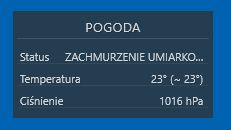
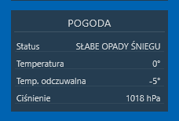

<p align="center">
   
</p>

# Illustro PRO weather widget

A minimal Rainmeter weather skin displaying live weather conditions using the OpenWeather API.

## About

This repo contains a lightweight weather widget for [Rainmeter](https://www.rainmeter.net/) that displays current weather information directly on your desktop.

The skin currently shows:

* Current weather status (in selected language)
* Current temperature
* Feels-like temperature
* Atmospheric pressure

The widget uses the **OpenWeather API** as the data source and refreshes weather information periodically to avoid unnecessary API requests.

## Configuration

Before using the skin, you need to configure your OpenWeather API key.

Open the `.ini` file and locate the `[Variables]` section:

```ini
latitude=50.286263
longitude=19.104078
language=pl
appid=YOUR_API_KEY
```

Update the values:

* `latitude` — your location latitude
* `longitude` — your location longitude
* `language` — language code used by OpenWeather (for example `en`, `pl`, `de`)
* `appid` — your OpenWeather API key

You can get an API key by creating an account on the OpenWeather website.

## Language

The weather status returned by the OpenWeather API can be translated automatically by changing the `language` variable in the configuration.

Example:

```ini
language=pl
```

This affects values returned by the API, such as:

* `clear sky` › `bezchmurnie`
* `few clouds` › `małe zachmurzenie`
* `light rain` › `lekki deszcz`

The widget labels are **not translated automatically**. I was too lazy to add a language system for the static text, so you need to translate these manually in the `.ini` file if you want to use another language.

Simply edit the `Text=` values in the meter sections to match your preferred language.


## Credits

This skin is based on the **Illustro Pro** Rainmeter style created by **pein**.
The original source/link for the Illustro Pro skin is no longer available, but the visual style and structure of this project are based on that work.
